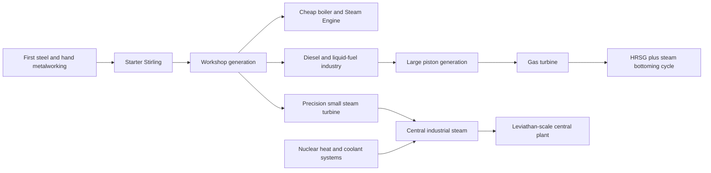

# RTM/Deadhour generator progression, feature, recipe and realism audit

> **Historical evidence.** Preserved incoming investigation and implementation record; values describe its recorded stages. For current behavior use the [current reference](../generator_reference.md).

**Source snapshot: 2026-10-14. The original audit below is historical. The implemented generator contract at the end of this document supersedes its proposed ratings, storage, recipes and compatibility findings.**

The audit confirms unintended electrical storage, but the Steam Engine comparison needs an important qualification: **the small turbine dominates once steam supply scales up; it does not deliver 500 kW from the first boiler.** Its titanium and plastic dependencies also make it technologically later than its simple crafting recipe suggests.

No recipes, ratings, configurations or saves were changed by this audit. This is a source-and-recipe audit of the current working tree, including existing uncommitted work. Figures below are calculated at 20 TPS, not measured in-game. Deadhour's deployed configuration and recipe overrides were not supplied.

## Principal findings

- Starter and Heavy Stirling retain **one second of nameplate output** electrically. Their recipes contain no electrical storage system.
- Steam Engine retains **20 seconds**, small and Industrial Turbines **10 seconds**, Turbofan and Gas Turbine **20 seconds**, and Leviathan approximately **33 minutes**.
- The small turbine accepts every physical steam grade, including **600°C/16 MPa ultrahot steam**, despite its relatively simple construction.
- The Steam Engine uses ordinary steam only. Its large footprint and material bill are poorly aligned with its modest output.
- Higher generators already offer useful differences—fuel compatibility, efficiency, throttling, heat recovery and protective trips—but large electrical reserves obscure those distinctions.
- Several legacy generators are disabled, uncraftable, or nominal abstractions. They should not be counted as functioning progression steps.
- The industrial piston engine's efficiency depends strongly on installed pistons. **“750 kW at 38%” is not its universal operating specification.**

## Accounting and census

The authoritative electrical unit is **0.5 J per quantum**, so one quantum/tick equals **10 W**. Rated generators share a tick export budget across cables, direct receivers and item charging. Several older generators instead inherit an export limit derived from electrical capacity; they can discharge much faster than they generate.

Sources: [electrical units](../../../src/main/java/api/hbm/energymk2/EnergyUnits.java), [rated generator contract](../../../src/main/java/api/hbm/energymk2/IRatedGenerator.java), [provider transfer contract](../../../src/main/java/api/hbm/energymk2/IEnergyProviderMK2.java), and [network distribution](../../../src/main/java/api/hbm/energymk2/PowerNetMK2.java).

The census covers provider interfaces, electrical mutations, network export, charging paths, registrations, subclasses and default recipes:

| Census group | Entries and disposition |
|---|---|
| External-heat generation | Starter Stirling; Heavy Stirling; Creative Stirling |
| Steam conversion | Steam Engine; Steam Turbine; Industrial Steam Turbine; Leviathan |
| Combustion generation | Diesel Generator; Industrial Combustion Engine; Turbofan; Combined Cycle Gas Turbine |
| Deprecated combustion | Wood Generator; inactive Industrial Generator |
| Radioisotope generation | RT Generator; Mini RTG; Polonium/Power RTG; RTG and Radiolysis Chamber |
| Other radiation generation | Radiation-Powered Engine; inactive Ambience Radiation Generator |
| Environmental generation | Solar Panel; Geothermal Electric Generator |
| Exotic conversion/generation | Matter Discharger; ZPE Potential Generator; legacy DFC Core Receiver |
| Configurable generation | Custom Machine with `generatorMode` enabled |
| Embedded generation without electrical export | Oil Well, Pumpjack and Fracking Tower with afterburn upgrades |
| Former recovery generator | Gas Flare: currently produces **zero electricity**, but retains legacy export/storage code |

**There is no separate active “Standard Steam Turbine” alongside the single-block turbine.** The standard turbine description belongs to `machine_turbine`; `machine_large_turbine` is the Industrial Steam Turbine.

Reactors, ITER/fusion equipment, solar boilers, Hephaestus, RTG furnaces, heaters and mechanical-only equipment are not additional direct electrical generators. Their heat/steam reaches the electrical converters above. The legacy DFC receiver is the distinct laser-to-electric conversion boundary. Batteries, capacitors and RF converters redistribute or convert supplied electricity rather than generate it.

Pack-defined Custom Machine instances cannot be enumerated without their configuration files. The source census includes that extension point explicitly.

## Generator mechanics: output, conversion and storage

“Expansion factor” below is a multiplier on the ledger's available expansion work. It is **not whole-plant thermal efficiency**. `H` means the sum of nominal RTG pellet heat values, including configured decay scaling.

| Generator | Represented technology | Actual generation/default ceiling | Conversion | Electrical reserve | Export ceiling |
|---|---|---:|---|---:|---|
| Starter Stirling | Small external-combustion engine and alternator | **10 kW**; 66.67 kW thermal intake | 15% heat-to-electric, additionally Carnot-limited | **10 kJ** | 10 kW aggregate |
| Heavy Stirling | Larger external-combustion engine and alternator | **40 kW**; 200 kW thermal intake | 20%, additionally Carnot-limited | **40 kJ** | 40 kW aggregate |
| Creative Stirling | Creative heat converter | Source-dependent, exempt nominal conversion | Creative exemption | Dynamic temporary value | Creative path |
| Steam Engine | Reciprocating steam engine and alternator | **25 kW**; steam flow ≤0.30 kg/s | 70% expansion factor | **500 kJ** | 25 kW aggregate |
| Small/Standard Steam Turbine | Compact condensing turbine-generator | **500 kW**; flow ≤0.75 kg/s | 75% expansion factor | **5 MJ** | 500 kW aggregate |
| Industrial Steam Turbine | Central turbine-generator | **5 MW**; flow ≤8 kg/s | 85% expansion factor | **50 MJ** | 5 MW aggregate |
| Leviathan | Large protected turbine-generator | **25 MW**; flow ≤40 kg/s | 88% expansion factor | **50 GJ** | 25 MW aggregate |
| Diesel Generator | Compact compression-ignition genset | **200 kW** | 32% diesel/cracked diesel; 30% reform blends; 27% petroil | **25 kJ**, potentially higher saved capacity | 200 kW aggregate |
| Industrial Combustion Engine | Large reciprocating genset | **750 kW**, scaled by throttle | Piston/fuel dependent, up to 38% | **1.25 MJ** | 750 kW aggregate |
| Turbofan | Jet-derived electrical generator | **1 MW** | 25%; afterburn levels reduce it to 12.5%, 8.33%, 6.25% | **20 MJ** | 1 MW aggregate |
| Combined Cycle Gas Turbine | Gas turbine with integrated HRSG | **3 MW gross**; about **2.94 MW before HRSG pumping** | 30% direct; 55% recoverable exhaust allocation | **60 MJ** | 3 MW aggregate |
| Wood Generator | Deprecated solid/liquid combustion generator | **40 kW** | 7% chemical-to-electric | **50 kJ** | 40 kW aggregate |
| RT Generator | Pellet-fed thermoelectric converter | **50H W**; default decay-mode cap **30 kW** | Nominal pellet multiplier; no physical thermal efficiency established | **50 kJ** | Capacity-derived 1 MW |
| Mini RTG | Sealed isotope thermoelectric unit | Fixed **7 kW** | No isotope heat/efficiency calculation | **700 J** | Capacity-derived 14 kW |
| Power/Polonium RTG | Stronger sealed isotope unit | Fixed **25 kW** | Same nominal implementation | **25 kJ** | Capacity-derived 500 kW |
| RTG/Radiolysis Chamber | Isotope conversion plus radiolysis | **100H W**, using ten pellet slots | Nominal multiplier; no shared physical energy split | **500 kJ** | Capacity-derived 10 MW |
| Radiation-Powered Engine | Waste/radiation conversion abstraction | Twelve fuel lanes; up to **3 MW** with radiation gems | Fixed fuel production/duration rows | **500 kJ** | Capacity-derived 10 MW |
| Solar Panel | Photovoltaic array | Approximately **1 kW peak** at unit sun strength; environment-dependent curve | No explicit area × irradiance × efficiency ledger | **500 J** fresh capacity | Capacity-derived 10 kW |
| Geothermal Electric Generator | Small thermoelectric contact converter | 0.25–5 kW per source contact | Fixed block-dependent output | **250 J** | Capacity-derived 5 kW |
| Ambience Radiation Generator | Ambient-radiation concept | **Zero** in active source | No implemented source | Nominal 250 J capacity | No sustained generation |
| Matter Discharger | Fictional material conversion device | **8 MJ/U-233** or **40 MJ/electronium** per completed conversion | Fixed burst yield | Nominal **250 MJ**; admission does not enforce that ceiling | Capacity-derived 5 GW |
| ZPE Potential Generator | Fictional tower generator | **150 W per valid shaft segment** | Geometry-dependent constant | **50 kJ** | Capacity-derived 1 MW |
| Legacy DFC receiver | Laser/core-output conversion adapter | Incoming value ×5,000 quanta per update | Nominal legacy conversion | Replaced each update | Dynamic incoming supply |
| Custom Machine generator mode | Pack-defined generator | Recipe consumption field becomes generation | Config-defined, without a physical fuel ledger | Config-defined | Capacity-derived |
| Three oil-extraction machines | Embedded gas recovery | Afterburn level 1–3: **1–3 kW**, used internally | 20% chemical conversion | Consumer buffers: 50 kJ /125 kJ /2.5 MJ | **No generator cable export** |

The geothermal machine can report the sum from two contacts above what its 500-quantum buffer can hold. Generation is clamped after insertion, so its reported source sum is not necessarily delivered electrical output.

The steam implementation uses a common direct-to-spent-steam conversion. It does not repeatedly credit intermediate turbine stages. Sources: [steam states and work](../../../src/main/java/com/hbm/realsim/SteamLedger.java), [thermal conversion](../../../src/main/java/com/hbm/realsim/ThermalMachine.java), and [Stirling implementation](../../../src/main/java/com/hbm/tileentity/machine/TileEntityStirling.java).

## Generator mechanics: operation and infrastructure

Placement dimensions describe the machine envelope, excluding external boilers, fuel processing, pipes, condensers and storage.

| Generator | Fuel/thermal storage and source | Startup, throttle and automation | Cooling, byproducts, maintenance and safety | Footprint |
|---|---|---|---|---|
| Starter/Heavy Stirling | Qualified process heater below; generator owns no fuel tank or thermal reservoir | Automatic against electrical buffer room; no authoritative spool model | Integral 20°C ambient sink; rejected heat is accounted; generator itself makes no ash/exhaust. Cog failure code remains, but compliant governed intake does not exceed its limit | Each 3×3×2 |
| Steam Engine | 2,000 ordinary-steam units =20 kg water equivalent; 20 kg spent-steam capacity | Automatic admission; rotor acceleration is animation rather than an output startup gate | Stops at full electrical/exhaust storage; no turbine-style rupture check found; boiler hazards remain external | 3×7×2 |
| Small turbine | 64,000 inlet units; 128,000 spent-steam units | Automatic; fluid selectors, container handling, item charging, computer integration; no paid spool | Both fluid tanks full causes rupture. No lubricant or maintenance model. External condenser is needed for recycling, but not checked before generation | One block |
| Industrial turbine | 512,000 inlet units; 10,240,000 spent units | Similar automatic conversion, item charging and computer integration | Both tanks full causes rupture; electrical saturation pauses admission; no lubrication/wear requirement | 3×5×2 |
| Leviathan | **1 billion inlet and 1 billion spent units** | Automatic conversion; computer integration; lever/controller-redstone trip reset | Overpressure and “overspeed” trips. Overspeed is currently inferred from full electrical storage, not rotor kinetic energy | Large stepped multiblock |
| Diesel | **400 L** actual fresh fuel tank | Automatic fuel/load response; no manual throttle or paid startup | Air/waterlogging checks; smoke, pollution and CO. No operating lubricant, cooling-water or repair requirement | One block |
| Industrial piston engine | **4,000 L** fuel tank; separately installed piston set | On/off control; throttle 0–30; immediate generation when eligible | Air/waterlogging checks; pollution/CO. Piston sets select compatibility/efficiency; no piston wear loop or operating lubricant/coolant requirement | 2×6×2 |
| Turbofan | **24,000 L** aviation fuel; separate 24,000-unit blood tank | Automatic; afterburn upgrades; visual momentum does not limit electrical startup | Atmospheric intake, pollution, CO, entity-intake/blood behavior; no paid HRSG output, operating lube or repair loop | 3×7×3 |
| Gas turbine/HRSG | **100,000 standard L gas**, **16,000 L lubricant**, **16,000 L water**, 160,000 steam-output units | Manual/remote start; **580 successful startup ticks ≈29 s**; RPM ramp; throttle, minimum running load and automatic mode | Lubricant **0.06 L/min**; paid auxiliaries and HRSG pumping; finite exhaust heat ownership; pollution/CO; shutdown sequence | 3×10×3 |
| Wood Generator | Solid fuel or **100 L** liquid tank; persistent unburned fuel credit | On/off, automatic refill and item charging | Air checks and soot; no operating coolant/lube or electrical-storage component | Legacy multiblock |
| RT Generator | Fifteen isotope pellets | Automatic; configured pellet decay/scaling | Decay continues while loaded; excess electricity is clipped. No explicit cold-side thermal constraint or maintenance | One block |
| Mini/Power RTG | Isotope represented by crafting ingredients | Immediate constant output | No installed isotope identity, decay tracking or heat-rejection calculation | One block each |
| Radiolysis chamber | Ten pellets; three **2,000-unit** fluid tanks | Automatic electrical output; fluid cracking above heat threshold; sterilization at higher threshold; item charging | Electrical and process behavior share nominal pellet heat without a physical allocation ledger | 3×3×3 |
| Radiation engine | Twelve fuel lanes; waste/gem lifetimes and depletion products | Automatic lane processing | Consumes fuel lifetime even when electrical storage is full; no physical heat-rejection model | One block |
| Solar | Sun, sky access, time and celestial-body multiplier | Automatic environmental response | No fuel, coolant, pollution or maintenance; daylight phase calculation needs runtime verification | 5×1×1 |
| Geothermal contact generator | Lava/geyser contacts above/below | Automatic environmental response | Random lava conversion; no cold-side model. The conversion writes below the generator even when checking the upper contact | One block |
| Matter Discharger | Single input item and electrical storage | 100 processing ticks; cooling from 2,000°C at 5°C/10 ticks | Converted products; creative battery triggers a large explosion. Accepted fuel/result mismatch discussed below | One block |
| ZPE | Valid hollow shaft segments between top/bottom | Structure checked periodically; automatic generation | No fuel, cooling, pollution or physical energy source | 3×3 shaft, variable height |
| DFC receiver | **64,000 cryogel units** | Incoming laser-driven update | Uses 20 cryogel/update while receiving; becomes lava without coolant; wrong-side laser destroys it | One block |
| Flare | **64,000-unit** disposal tank | On/off; vent/burn modes; speed upgrades | Burn/vent pollution, atmosphere interaction and flame damage; **no generated electricity** | Tall multiblock |
| Oil recovery rigs | Oil/gas buffers generally 64,000 units; fracking solution also buffered | Afterburn upgrade burns recovered gas before extraction work | Recovery offsets consumption; it is not a standalone exported generator | Extraction multiblocks |
| Custom generator | Pack-defined inventory, fluids, structure and recipe | Recipe-driven | Configured pollution/radiation; processing continues into a full electrical buffer and clips output | Config-defined |

Most generators have **no substantive repair or wear progression**. The major exception is continuing lubricant consumption in the gas turbine. Merely installing a piston set or upgrade does not establish maintenance behavior.

## Electrical-storage classification

A = physically justified storage. B = a small implementation buffer. C = unjustified electrical reserve.

**Reserve duration = stored joules /rated watts.**

| Generator | Duration at nameplate | Classification | Assessment |
|---|---:|---|---|
| Starter Stirling | **1 s /20 ticks** | **C** | Governed generation was given a rating-dependent accumulator; no storage hardware |
| Heavy Stirling | **1 s /20 ticks** | **C** | Same problem |
| Steam Engine | **20 s /400 ticks** | **C** | Gear/flywheel representation does not implement electrical storage |
| Small turbine | **10 s /200 ticks** | **C** | No battery bank or storage converter |
| Industrial turbine | **10 s /200 ticks** | **C** | Same |
| Leviathan | **2,000 s /33 min 20 s** | **C** | Beryllium flywheel exists in recipe, but no inertia-to-electric model supports this reserve |
| Diesel | **0.125 s /2.5 ticks** fresh | **B, provisionally** | Already close to a discrete-transfer buffer; saved capacities can be larger |
| Industrial piston engine | **1.67 s /33.3 ticks** | **C** | No corresponding storage subsystem |
| Turbofan | **20 s** | **C** | Rotor animation is not storage conversion |
| Gas turbine | **20 s gross nameplate** | **C** | Startup/RPM/lubrication do not justify a 60 MJ electrical bank |
| Wood Generator | **1.25 s** | **C** | Deprecated reserve without storage hardware |
| RT Generator | **1.67 s at 30 kW**; longer with weaker pellets | **C** | Small circuit capacitors inside RTG units do not establish a 50 kJ bank |
| Mini RTG | **0.1 s /2 ticks** | **B, provisionally** | Fits a small transfer buffer; isotope mechanics remain a separate problem |
| Power RTG | **1 s** | **C** | Uncraftable legacy variant with larger reserve |
| Radiolysis chamber | `500,000 /(100H)` seconds | **C** | No electrical-storage components |
| Radiation engine | **0.167 s at 3 MW**, much longer on ordinary waste | **C** | Reserve/export behavior is unrelated to installed source rating |
| Solar | **0.5 s at 1 kW** | **C → B candidate** | Arbitrary ten-tick fresh buffer; no demonstrated requirement |
| Geothermal | **0.05 s at its 5 kW export limit** | **B, provisionally** | One-tick scale at the effective ceiling |
| ZPE | **333.3 /segment count seconds** | **C** | Arbitrary bank |
| Matter Discharger | Not a continuous nameplate generator | **A in concept** | Recipe includes **twelve battery blocks**. Capacity enforcement still needs correction |
| DFC receiver | Approximately one update's incoming output | **B-like adapter** | Replaces supply each update; needs a coherent conversion contract |
| Flare/inactive generators | No fresh generation | Dormant legacy reserve | Remove from fresh progression/status claims, preserve saved contents |
| Custom generator | Config-dependent | Config-dependent | Must be assessed per pack definition |
| Oil recovery rigs | Consumer working buffers | Separate consumer assessment | Do not treat their entire electrical input buffer as an exported generator bank |

A flywheel can store kinetic energy, but an electrical reserve needs a model for motor/generator conversion, speed, losses and discharge. The current Leviathan has none. This distinction follows the [DOE flywheel description](https://arpa-e.energy.gov/programs-and-initiatives/search-all-projects/next-generation-flywheel-energy-storage).

A reasonable proposed starting point is **two ticks of electrical output**, subject to network-order verification:

| Generator | Proposed two-tick technical reserve |
|---|---:|
| Starter /Heavy Stirling | 1 kJ /4 kJ |
| Steam Engine | 2.5 kJ |
| Small turbine at proposed 100 kW | 10 kJ |
| Diesel | 20 kJ |
| Industrial piston engine | 75 kJ |
| Turbofan | 100 kJ |
| Gas turbine | 300 kJ |
| Industrial turbine | 500 kJ |
| Leviathan | 2.5 MJ |

These are candidate implementation buffers, not approved capacities. **Shrinking Leviathan storage alone would make its current full-buffer “overspeed” trip fire much more frequently.** Admission, export timing and protective logic must be corrected together.

Unburned fuel credit and admitted steam mass are separate owned energy/material accounts. They must not be deleted as though they were electrical batteries.

## Recipe/progression table

`P528` means cast plate under fresh default 528 mode and ordinary plate outside it. Fabrication Machine and Industrial Fabrication Machine currently share the recipe pool; there is no implemented exclusive heavy-fabrication gate.

| Generator | Actual default crafting bill | Station and earliest practical industry |
|---|---|---|
| Starter Stirling | 16 planks; 6 steel plates; 8 copper ingots; 4 copper coils; 1 iron large gear | Tier-2 steel anvil; first steel, forming/wire production and red-copper alloy |
| Heavy Stirling | 16 steel plates; 6 beryllium; 8 copper; **16 gold coils**; 1 steel large gear | Tier-2 anvil; beryllium, substantial gold wiring and titanium gear core |
| Steam Engine | 16 reinforced stone; 12 steel plates; 2 steel shells; 4 copper coils; 1 iron large gear | Tier-2 anvil; common mechanical workshop and pressure-shell forming; boiler/feedwater/outlet required to operate |
| Small turbine | 4 steel ingots; 1 titanium rotor; 2 copper coils; 2 plastic ingots | Crafting table; titanium forming and polymer/bakelite chemistry |
| Industrial turbine | 12 steel P528; 4 rubber; 3 titanium rotors; 6 dense gold wire; 3 Dura pipes; 4 steel pipes; 4 Basic Boards | Fabrication; casting in default mode, advanced metallurgy and basic electronics |
| Leviathan | 6 steel shells; 16 welded steel plates; 12 titanium P528; 16 resistant-alloy ingots; 5 tungsten rotors; 3 titanium rotors; beryllium flywheel; 2 dense gold wires; 16 Dura pipes; 16 steel pipes; 2 SmCo ingots | Fabrication plus casting/welding, W-Co steel, Be, titanium and magnetic materials |
| Diesel | Steel shell; selenium-named piston; cast steel plate; 4 copper coils; steel tank; 2 steel pipes; Analog Board | Fabrication **or tier-2 anvil copy of its recipe**; tungsten/Dura bolt, titanium tank plates and analog electronics; liquid-fuel supply |
| Industrial piston engine | 12 steel P528; 8 iron plates; 8 copper; 6 dense gold wires; 2 steel tanks; 16 tungsten bolts; 24 red-copper fine wires; Basic Board | Fabrication, metallurgy/electronics; **piston set must also be made and installed** |
| Turbofan | 3 steel shells; 3 titanium shells; 1 tungsten rotor; **7 titanium rotors**; 4 Dura pipes; 12 red-copper ingots; 24 red-copper fine wires | Fabrication; many rotating parts, W-Co steel and aviation-fuel processing |
| Gas turbine/HRSG | 10 steel shells; 12 dense gold wires; 4 Dura pipes; 8 scaffolds; 4 steel pipes; 3 tungsten rotors; 2 motors; 4 rubber; 3 Basic Boards | Fabrication, high-temperature metallurgy, electronics, processed gas and lubricant supply |
| RT Generator | 3 RTG units; 4 steel P528; 4 red-copper fine wires; 3 plastic | Fabrication; thermoelectric elements and capacitor components; usable isotope pellets are additional |
| Mini RTG | 3 lead plates; **3 Pu-238 or Tm-170 billets**; 2 thermoelectric elements; 1 RTG unit | Crafting table final assembly, but RTG-unit fabrication and isotope production are prerequisites |
| Power RTG | Polonium-based recipe is commented out | Registered legacy/creative equipment; no default survival route |
| Radiolysis chamber | 4 resistant-alloy ingots; 8 rubber; 12 lead P528; 4 cast copper plates; 8 thermoelectric elements; 3 steel tanks | Fabrication, resistant metallurgy, shielding and isotope supply |
| Radiation engine | 8 steel ingots; 32 steel plates; 6 magnetized-tungsten coils; 24 matching fine wires; **16 Basic Boards**; 3 reactor cores; starmetal; red dye; journal gate | **Non-528 mode only**; late/exotic metallurgy and nuclear-material chain |
| Solar | 4 stainless plates; 4 photo panels; 2 plastic; 8 red-copper fine wires; 4 scaffolds; Basic Board | Fabrication; semiconductor, PCB, polymer and stainless production |
| Geothermal contact generator | 4 Dura ingots; 2 thermoelectric elements; 2 cast copper plates; coated cable | Crafting table; foundry/casting and W-Co steel; suitable environmental site |
| Ambience Radiation Generator | No active default recipe found | Registered inactive legacy block |
| Matter Discharger | 3 magnetized tungsten; gallium; 24 nickel plates; 20 steel plates; GaAs billet; 2 rubber; **12 battery blocks**; 2 Advanced Boards | Fabrication; battery industry, advanced electronics, solvent and exotic metallurgy |
| ZPE | Each endpoint: 2 magnetized tungsten, Desh plate, 4 lead plates, Advanced Board, magnetized-tungsten coil; endpoint conversion recipes also exist | **Non-528 mode only**; exotic metallurgy and advanced electronics; shaft walls can be arbitrary non-air blocks |
| DFC receiver | Default recipe commented out | Legacy/creative adapter |
| Wood Generator | Default crafting recipe commented out | Deprecated, old-world compatible |
| Industrial Generator | Construction recipe and generation loop commented out | Inactive legacy equipment |
| Creative Stirling | No survival recipe | Creative/debug only |
| Oil Well recovery | 20 scaffolds; 2 tanks; motor; steel pipe; titanium drill; 4 welded steel plates; Basic Board; afterburn upgrade separately | Petroleum extraction/fabrication |
| Pumpjack recovery | 8 scaffolds; 8 welded steel plates; 4 pipes; 4 tanks; Desh motor; hydraulic piston; 8 steel bolts; Analog Board; afterburn separately | More advanced extraction and mechanical fabrication |
| Fracking recovery | 40 scaffolds; 64 concrete; titanium drill; 2 Desh motors; 6 Desh plates; 16 capacitors; 24 tanks; 2 pipes; afterburn separately | Late extraction, solution production and exotic fabrication |
| Custom generator | Pack-defined construction and operating recipe | Pack-defined; generated example defaults to **generator mode off** |

Sources: [crafting recipes](../../../src/main/java/com/hbm/main/CraftingManager.java), [anvil construction](../../../src/main/java/com/hbm/inventory/recipes/anvil/AnvilRecipes.java), [fabrication recipes](../../../src/main/java/com/hbm/inventory/recipes/AssemblerRecipes.java), and [circuit production](../../../src/main/java/com/hbm/inventory/recipes/SolderingRecipes.java).

## Important transitive dependencies

| Component family | What its recipe actually requires | Progression implication |
|---|---|---|
| “Copper” coil | Eight **red-copper/Mingrade fine wires** around iron | It is an alloy-winding abstraction, not simply ordinary copper wire |
| Gold coil | Eight gold fine wires around iron | Heavy Stirling requires 128 gold fine wires through its sixteen coils |
| Large gear | Iron plates +copper core; steel variant uses steel plates +titanium core | Mechanical scale is represented, but it is not a complete piston/crank assembly |
| Titanium rotor | Eight blades +steel shaft/core | Visible blade crafting expands one rotor to **16 titanium ingots +8 titanium plates** |
| Tungsten rotor | Eight tungsten blades +Dura core; dysprosium alternative gives sixteen rotors | Rare-earth route heavily changes effective rotor cost |
| Steel tank | Six steel plates +two titanium plates produce four tanks | Even “steel tank” dependencies include titanium |
| Diesel piston | Five steel plates +tungsten ingot +Dura bolt | Despite the item name, the shown bill does not contain selenium |
| Industrial steel piston set | 16 steel plates, 4 copper plates, 8 tungsten ingots, 16 tungsten bolts | Generator chassis alone cannot operate |
| Dura piston set | 24 Dura ingots, 8 titanium plates, 8 tungsten ingots, 16 Dura bolts | Improved compatibility/efficiency has a genuine metallurgy bill |
| Dura alloy | Steel/tungsten/cobalt foundry route | A meaningful industrial metallurgy dependency |
| RTG unit | 2 thermoelectric elements, cast copper plate, 2 lead, 2 steel plates, capacitor | Represents conversion/containment and controls; not a large accumulator |
| Thermoelectric element | Steel, wire and quartz route; alternative mercury or bismuth/tellurium anvil routes | Alternative realism and availability differ |
| Analog Board | Vacuum tubes, capacitors, PCBs and lead wiring | Can precede semiconductor-heavy boards |
| Basic Board | Chips/silicon, PCBs and solder; germanium alternative | Electronics prerequisite, not mechanical precision manufacture |
| Capacitor Board | Tantalum capacitors, PCB, lead wiring and solvent; terbium alternative | Adds chemistry and rare-material dependencies, not pressure hardware |
| Photo panel | Glass, polymer plates, silicon component and PCB | Credible semiconductor progression |
| Plastic | Polymer or bakelite routes | Chemical infrastructure; insulation plates have earlier substitutes, but those do **not** replace the small turbine's actual plastic ingredient |
| Steel bootstrap | Unpowered Metallurgical Furnace and burner/hand forming routes | Starter power does not intrinsically require powered steelmaking |
| Fabrication bootstrap | Tier-2 anvil construction with glass, steel, copper, motors and vacuum tubes | Starter 10 kW can supply its default **3 kW** lane |
| Common powered processing | Press 2 kW; generic chemistry 4 kW; furnace 8 kW | Parallel operation needs additional generation or external storage |

No unavoidable circular dependency was established in the inspected fresh-default generator routes. That is a source conclusion, not a clean-world survival demonstration. OreDictionary substitutions, custom recipes and pack changes can alter it.

There is **no active craftable dedicated alternator component in the checked generator recipes**. `generator_steel` appears in a commented legacy bill. Reusing current coils, motors and structural parts is preferable to resurrecting that dead component without a manufacturing plan.

## Quantitative recipe-cost comparison

These vectors expand the visible crafting routes. They are game-material equivalents, not kilograms or a universal currency. Prerequisite-machine construction is excluded.

| Early generator | Common Fe/steel/Cu equivalents | Other metal/alloy equivalents | Mechanical/electrical components | Chemistry /station |
|---|---:|---|---|---|
| Starter Stirling | **27** | 4 red-copper alloy | Iron gear; 4 coils; 16 planks | No polymer; tier-2 anvil |
| Heavy Stirling | **48** | **16 gold, 6 Be, 1 Ti** | Steel gear; **16 coils** | Advanced material access; tier-2 anvil |
| Steam Engine | **33** | 4 red-copper alloy | Iron gear; 2 shells; 4 coils; 16 cheap reinforced stone | No polymer; tier-2 anvil |
| Small turbine | **7** | **24 Ti**, 2 red-copper alloy | Precision rotor; 2 coils | **2 plastic**; crafting table |

Thus:

- The small turbine is lighter in common structural material.
- Its titanium and chemical prerequisites are materially more sophisticated.
- Heavy Stirling's **gold/beryllium bill** is disproportionate to its workshop role.
- Steam Engine carries the bulkier bill and footprint without explicitly buying cylinders, pistons or valve gear.

For larger neighbors, the meaningful cost vectors are rotor count, pressure structure, alloy processing and controls—not the final number of ingredient entries:

| Neighbor | Mechanical/pressure cost vector | Electrical/control cost | Main mismatch |
|---|---|---|---|
| Industrial piston engine | Large cast chassis, tanks, separately paid piston set | Copper/red-copper wiring, six dense gold wires, Basic Board | Fuel-specific piston efficiencies complicate its supposed upgrade |
| Industrial turbine | Three Ti rotors, cast structure, Dura/steel pipes | Six dense gold wires, four Basic Boards | No explicit scaled alternator or lubrication/bearing package |
| Gas turbine | Three W rotors, ten shells, Dura piping, scaffolds | Motors, gold wire, three Basic Boards | Integrated HRSG/compressor/combustor hardware is underrepresented |
| Leviathan | Five W +three Ti rotors, welded/cast structure, Be flywheel, resistant alloy | SmCo and gold wire | Mechanical scale is represented; 50 GJ electrical storage is not |

Expensive mode replaces selected material bills with heavy components. A heavy component represents **768 ingot equivalents**, so those substitutions are substantial progression changes, not cosmetic ingredient replacements.

## Recipe realism table

These grades evaluate conceptual construction. They do not certify the runtime mechanics.

Real Stirling conversion requires hot/cold heat exchange, a working chamber, moving piston/displacer mechanism and an alternator; a flywheel is not universal to every Stirling design. [NASA's conversion description](https://science.nasa.gov/planetary-science/programs/radioisotope-power-systems/dynamic-power/)

Reciprocating engines need cylinders/pistons, crankshaft, fuel delivery, lubrication, cooling and generator hardware. Gas turbines need compressor, combustor and turbine sections, with demanding hot-section materials. [DOE engine review](https://www.energy.gov/sites/prod/files/2013/11/f4/chp_review.pdf), [NETL turbine components](https://netl.doe.gov/node/5438)

| Generator | Grade | Recipe assessment and direction |
|---|---|---|
| Starter Stirling | **B** | Gear, steel, copper and coils are defensible abstraction; hot/cold exchangers and piston/displacer are weakly represented. Improve mechanical bill without advanced circuits |
| Heavy Stirling | **C** | Scaling through sixteen gold coils and Be does not explain the difficult engine hardware. Prefer larger steel/copper heat hardware and mechanical parts |
| Steam Engine | **C** | Shells/gear/coils partly represent pressure and generation; missing piston/cylinder/valves. Stone dominates footprint/cost presentation |
| Small turbine | **B for low-grade duty; C for current full-grade access** | Actual blades, shaft and windings are good. Simple casing/plastic does not justify every steam condition |
| Industrial turbine | **B** | More rotors, cast structure and pipes are defensible. Bearings, lubrication and alternator scale need clearer representation |
| Leviathan | **B construction; C storage feature** | Substantial rotating/high-temperature hardware; electrical reserve lacks a corresponding system |
| Diesel | **B** | Piston, casing, tank, piping and coils are representative. Cooling, crank and lubrication remain abstract |
| Industrial piston engine | **B when installed piston set is included** | The operational bill contains genuine piston metallurgy. Chassis recipe alone is misleading |
| Turbofan | **C for its electrical identity** | Many rotors and shells resemble jet machinery. Explicit generator and distinction between fan/thrust and electrical shaft output are unclear |
| Gas turbine/HRSG | **C** | Hot rotors and controls are present, but compressor, combustor and heat-recovery exchanger are not clearly bought |
| RT Generator | **B** | RTG units carry thermoelements, containment and copper heat hardware. Isotope heat and rejection need a physical runtime ledger |
| Mini RTG | **B recipe; C runtime representation** | Isotope/lead/thermoelements are recognisable, but Pu/Tm routes become the same perpetual fixed-output block |
| Power RTG | **C /obsolete** | Disabled bill and fixed output; unsuitable as a fresh progression reward |
| Radiolysis chamber | **B hardware; C energy allocation** | Shielding, tanks and thermoelements fit. Simultaneous useful electrical/process output needs a shared isotope-energy budget |
| Radiation engine | **D as real technology** | Magnetized tungsten, reactor cores and starmetal do not establish a real waste-power conversion process. Treat as explicit exotic technology |
| Solar | **B** | Semiconductor panels, glass, wiring, polymer and frame fit photovoltaic construction |
| Geothermal contact generator | **B recipe; C thermal model** | Thermoelements/copper fit a thermoelectric converter; hot/cold difference and heat depletion are not modelled |
| Wood Generator | **C /deprecated** | Commented furnace/coil bill did not clearly represent the heat engine |
| Industrial Generator | **C /inactive** | Historical mixed-fuel/RTG bill; authoritative implementation is disabled |
| Flare | **C** | Current function is disposal, but recipe still includes three thermoelectric elements. Remove obsolete recovery implications |
| Ambience Radiation Generator | **D /inactive** | No functioning physical conversion path |
| Matter Discharger | **D physical realism; coherent battery inclusion** | Fictional transformation, but twelve batteries justify intentional electrical storage |
| ZPE | **D physical realism** | Explicit fictional generation; arbitrary wall material is not a real energy source |
| DFC receiver | **D physical realism** | Legacy fictional conversion with arbitrary multiplier and coolant requirement |
| Custom generator | **Config-dependent** | No universal technology or realism grade |
| Oil recovery rigs | **C for recovery hardware** | Extraction bills buy drills/pumps; generic afterburn upgrades do not explicitly represent a gas engine or turbine |

RTGs require an isotope heat source, thermoelectric conversion and heat rejection; they are not rechargeable electrical accumulators. [NASA RTG explanation](https://science.nasa.gov/resource/how-does-a-radioisotope-thermoelectric-generator-rtg-work-the-seebeck-effect/)

Photovoltaics directly convert sunlight using semiconductor material; batteries are an additional subsystem. [DOE photovoltaic basics](https://www.energy.gov/cmei/systems/solar-photovoltaic-cell-basics)

## The early-power comparison

All figures assume continuous supply and available electrical/exhaust destinations.

| Criterion | Starter Stirling | Heavy Stirling | Steam Engine | Small turbine |
|---|---|---|---|---|
| Electrical nameplate | 10 kW | 40 kW | 25 kW | 500 kW |
| Main prerequisites | Steel workshop | Be, gold wiring, Ti gear core | Steel workshop and shell forming | Ti rotor and polymer chemistry |
| Operating plant | Qualified heater | Qualified heater | Heater/boiler, fresh water, steam/exhaust transport | Same steam infrastructure |
| Qualified heat intake | 66.67 kW | 200 kW | Determined by boiler | Determined by boiler |
| One 200 kW thermal boiler | Not applicable | Not applicable | **≈13.23 kW** | **≈14.18 kW** |
| Expansion /heat efficiency | 15% heat-to-electric | 20% heat-to-electric | 70% available expansion work | 75% available expansion work |
| Approximate cold-feed fuel efficiency with 85% heater and 98% boiler | 12.75% | 17% | **5.62%** | **6.03%** |
| Steam capability | None | None | Ordinary only | All four grades |
| Electrical reserve | 1 s | 1 s | 20 s | 10 s at rating |
| Startup | Heat-source dependent; no generator spool | Same | Boiler pays warmup; rotor animation does not gate output | Same boiler requirement; no turbine spool gate |
| Automation | Automatic against buffer room | Same | Automatic | Automatic plus item/container/computer conveniences |
| Generator safety | Governed intake | Same | No comparable turbine rupture check | Full inlet +full exhaust rupture |
| Generator footprint | 3×3×2 | 3×3×2 | **3×7×2** | **One block** |

The first boiler has a 200 kW thermal transfer ceiling and 98% steam-production factor. Ordinary steam requires 2.59169 MJ/kg from cold feed; its full expansion row offers 250 kJ/kg before machine factor.

That produces:

- Steam Engine: `200 kW ×0.98 ×175/2591.69 ≈13.23 kW`.
- Small turbine: `200 kW ×0.98 ×187.5/2591.69 ≈14.18 kW`.

With ample steam, their limits diverge:

| Steam grade | Small turbine | Industrial turbine | Leviathan |
|---|---:|---:|---:|
| Ordinary | **140.6 kW** | 1.70 MW | 8.80 MW |
| Hot | 309.4 kW | 3.74 MW | 19.36 MW |
| Superhot | 433.1 kW | 5 MW ceiling | 25 MW ceiling |
| Ultrahot | 500 kW ceiling | 5 MW ceiling | 25 MW ceiling |

**Why build the Steam Engine currently?** It is reachable before titanium/plastics, avoids Heavy Stirling's gold/Be bill, and lacks the turbine's generator-local rupture behavior. Those are defensible advantages.

However, its large footprint, bulk bill and weak mechanical representation make that early niche unattractive. Once titanium/plastics and larger steam supply are available, the small turbine's compactness, flow, steam-grade access and conveniences overwhelmingly win.

## Dominance table

“Strict dominance” requires winning every relevant dimension, including prerequisites and safety—not just watts.

| Neighbor pair | Output /efficiency | Cost /prerequisites | Automation /footprint | Fuel /storage /startup | Verdict |
|---|---|---|---|---|---|
| Starter →Heavy Stirling | 4× output; 15→20% | Much higher Be/gold/Ti burden | Same automation and footprint | Same heat logistics/startup; both accidental banks | Valid workshop upgrade, poor material direction |
| Starter →Steam Engine | Only modestly higher output on first boiler; lower whole-fuel efficiency | More mechanical/boiler infrastructure | Much larger plant | Water/exhaust burden; boiler warmup; larger reserve | Parallel option, not a mandatory upgrade |
| Heavy Stirling ↔Steam Engine | Heavy wins supplied-heat output/efficiency | Engine avoids Be/gold | Engine is much larger | Steam enables a boiler network; more logistics | Distinct access routes; current engine remains weak |
| Steam Engine →small turbine | Higher attainable output and expansion factor | Turbine needs Ti/plastic; lighter common structure | Turbine greatly more compact and convenient | Same steam source; turbine accepts higher grades; rupture risk | Strong post-unlock dominance, **not strict early dominance** |
| Small →Industrial turbine | More flow and better factor | Real metallurgy/fabrication cost | Larger footprint, similar conveniences | Similar logistics/startup; both ten-second banks | Valid throughput upgrade; small turbine's grade access weakens distinction |
| Industrial →Leviathan | More flow, modest factor gain | Much more rotating/structural hardware | Larger footprint; protective trips | Same steam family; enormous reserve; no real electrical spool | Valid central-scale role obscured by bank/trip coupling |
| Diesel →industrial piston | More output; efficiency can improve **or worsen** | Chassis plus expensive piston set | Manual throttle/control; larger footprint | Broader compatible fuels, larger tank; more stored electricity | Upgrade depends on installed piston and fuel |
| Diesel ↔Turbofan | More output; lower efficiency | Substantial rotor bill | Compact multiblock, automatic | Aviation fuel; giant tank; afterburn wastes fuel | Power-density niche, weak identity and upgrade behavior |
| Piston →Gas turbine | Higher output; direct efficiency can be lower | Hot-section/gas/lube infrastructure | RPM, remote/auto controls; larger plant | 29 s startup; minimum-load behavior; HRSG reward | Valid baseload/heat-recovery option, not universally better |
| Gas turbine →combined cycle plant | Additional electricity from paid exhaust heat | External steam turbine and condensate loop | Larger/complex plant | Same fuel; pumping and startup dependencies | Genuine efficiency reward |
| RT Generator ↔Mini RTG | Variable/decaying vs fixed 7 kW | Different isotope/conversion bills | Both compact/unattended | Mini bypasses isotope identity/decay | Inconsistent isotope progression |
| Solar ↔RTG/geothermal | Weather/daylight vs site/isotope dependence | Different industries | Unattended | No common fuel or uptime profile | Parallel specialist options |
| Wood →Stirling plant | Deprecated standalone vs current heat framework | Wood recipe absent | Legacy vs maintained plant | Wood offers inherited fuel convenience | Keep old-world compatibility; exclude from fresh ladder |

One particularly important piston result:

| Piston set using diesel's HIGH grade | Electrical efficiency |
|---|---:|
| Steel | **9.5%** |
| Dura | **34.2%** |
| Desh | **38%** |
| Starmetal | **38%** |

At 750 kW, fresh diesel consumption is approximately **13.22 L/min with steel pistons**, versus **3.67 L/min with Dura pistons**. The compact diesel needs approximately **1.05 L/min at 200 kW**. Those differences should be explicit progression rewards and operating guidance.

## Fuel and thermal storage

Internal fuel reserves also deserve correction:

| Machine | Current autonomy or storage implication |
|---|---|
| Diesel, 400 L | Approximately **6.4 hours** at rated output on diesel |
| Industrial piston, 4,000 L | Approximately **18.1 hours** with Dura pistons on diesel; about five hours with steel pistons |
| Turbofan, 24,000 L | Approximately **58 hours** at 1 MW without afterburn |
| Gas turbine, 16,000 L lubricant | Approximately **185 days** at its 0.06 L/min consumption |
| Gas turbine, 100,000 standard L fuel | Standard-equivalent gas amount; physical vessel volume depends on pressure, which is not established by this capacity |
| Small turbine inlet | **640 kg water equivalent on ordinary steam**, increasing with selected grade |
| Small turbine exhaust | **128 tonnes water equivalent** |
| Industrial turbine exhaust | **10,240 tonnes water equivalent** |
| Leviathan exhaust | **1 million tonnes water equivalent** |

Steam inventory units must not be read as literal gas litres. Nevertheless, these buffers bank substantial steam mass and enthalpy. The one-block turbine is effectively also a large steam-storage system.

Recommendations should scale fuel/steam capacity independently from power and throughput, account for admitted fractional parcels, and preserve old over-cap contents.

## Configuration and legacy distinctions

Fresh defaults currently use **528 mode enabled**, expensive mode disabled, and LBSM disabled.

- In 528 mode, P528 selects cast plates.
- Radiation-Powered Engine and ZPE recipes are excluded.
- Outside 528 mode, Industrial Turbine and Leviathan receive **10/50 Capacitor Boards** through `addTantalium`.
- Those boards are control components. They do not justify 50 MJ or 50 GJ electrical storage.
- LBSM can remove anvil-tier restrictions and change supporting material/chemistry availability.
- `hbmConfig/hbmMachines.json` overrides configurable fields.
- Existing non-underscore recipe files such as `hbmRecipes/hbmAssembler.json` replace corresponding defaults.
- Diesel's exposed `fuelCap` field is currently disconnected from its fixed 400 L constructor capacity.
- Diesel preserves a saved electrical capacity at least as large as the configured floor.
- Many other fluid tanks restore saved capacity; selected normalized tanks adopt fresh capacity while preserving over-cap stock.

Changing Java defaults alone does not establish what an existing server will run. The configuration writer materializes values, so a later migration must treat existing settings conservatively rather than guessing which were manually edited.

## Proposed correction plan — critical corrections

| Current behavior and recipe | Discrepancy | Proposed behavior | Recipe direction | Compatibility implications |
|---|---|---|---|---|
| Stirling/steam/combustion generators retain reserves listed above; most have no storage components | Generation banks electricity unrelated to technology | Use bounded one/few-tick working supply; retain genuine battery equipment | Do not add batteries to rationalize inherited banks | Preserve saved joules for controlled drain; prevent new banking; update all export/charging paths |
| Leviathan has 50 GJ and a Be flywheel; full electrical bank causes “overspeed” trip | Electrical fullness substitutes for rotor mechanics | Separate admission/load protection from any explicit rotor/inertia model | Keep mechanically justified flywheel; remove electrical-bank implication | Preserve trip/reset behavior; shrinking capacity requires coordinated control change |
| Small turbine's steel/Ti/plastic bill accepts every steam grade | Pressure/temperature capability exceeds construction | Restrict low-grade equipment; align higher-grade admission with stronger equipment | Pressure casing/seals/rotor metallurgy, rather than extra advanced boards | Drain saved incompatible-grade stock safely; retain fluid identities and quantities |
| Mini RTG's Pu/Tm recipes create identical perpetual 7 kW blocks | Isotope identity and decay disappear at crafting | Persist installed isotope/source inventory; derive output from paid heat and conversion | Retain isotope, containment, thermoelements and rejection hardware | Existing units need an explicit conservative legacy-source policy |
| RTG/radiolysis use nominal heat ×5/×10; radiolysis also performs processes | Physical heat and electrical/process rewards are not coherently defined | Establish one isotope heat ledger and allocate useful outputs | Existing thermoelements/tanks can remain; no arbitrary electronics inflation | Preserve pellet decay/NBT and isotope identities; avoid silently interpreting old heat values as joules |
| Matter Discharger accepts SA326/U-233 ore inputs but completion has narrower item-specific result cases; recipe has twelve batteries | Accepted input may not have a matching conversion result; storage ceiling is not enforced on admission | Align acceptance/results and refuse a conversion whose output cannot fit | Retain deliberate batteries; keep fictional transformation explicit | Preserve stored energy/items; do not discard over-cap legacy stock |
| Older generators export at capacity-derived limits | Storage determines discharge power; generation and export ratings differ | Give each active generator an explicit aggregate electrical output contract | No recipe change needed for this correction | Preserve external APIs through adapters; budget every port and charging path |
| Diesel exposes ineffective fuel-cap setting | Server configuration promises behavior it does not control | Honor a deliberate capacity override or migrate the setting explicitly | Existing tank abstraction can remain | Preserve contents; do not silently overwrite configured servers |
| Huge steam buffers in small/central turbines | Converter doubles as implausibly large thermal storage | Size admission/exhaust buffers from flow, parcel granularity and plant role | Dedicated external tanks should buy meaningful autonomy | Preserve stored mass and enthalpy; independent capacity migration |

## Proposed correction plan — progression improvements

| Current behavior and recipe | Proposed role/behavior | Recipe direction | Compatibility implications |
|---|---|---|---|
| Steam Engine: 25 kW, large common-material structure, weak piston representation | Cheap early boiler-driven generator; retain 25 kW ceiling initially | Reduce nonfunctional bulk; buy cylinders, piston/valve/gear hardware and windings using existing parts | Preserve ordinary-steam operation and boiler safety |
| Small turbine: 500 kW/all grades, one block, Ti rotor/coils/plastic | Precision low-grade turbine, proposed **50–100 kW** class | Retain real rotor; improve casing/shaft/bearing representation | Explicit fresh-default profile; preserve existing overrides until intentional migration |
| Heavy Stirling: 40 kW, sixteen gold coils and Be | Workshop external-heat upgrade | Scale steel/copper exchangers and mechanical hardware; justify or remove gold/Be requirements | Rating can remain; recipe change affects fresh crafting |
| Industrial piston: 750 kW with highly variable piston efficiency | Fuel-specific large engine; improved efficiency and throttling reward | Include piston installation in the documented operating bill; avoid more generic boards | Keep compatible installed sets and saves |
| Turbofan: 1 MW electricity, jet recipe, fixed output despite afterburn | Repurpose as an explicitly jet-derived/turboshaft genset, or separate propulsion behavior | Make electrical generator hardware explicit | Preserve legacy block; decide how afterburn/intake behavior fits the retained identity |
| Gas turbine: integrated HRSG under a generic turbine bill | High-density baseload generator; combined-cycle efficiency through external steam conversion | Represent compressor/combustor/hot rotor and heat exchanger using existing manufacturing families | Keep paid exhaust ownership and remote/RPM controls |
| Fuel tanks provide hours/days of autonomy | Compact internal service reserves; external storage supplies endurance | Tank count/size should correspond to autonomy | Preserve over-cap stock; no rescaling or throughput changes |
| Flare still buys thermoelements but generates zero | Disposal/safety equipment | Remove obsolete generation components and status implications | Preserve old-world block and any remaining saved electricity |

The current full-load gas turbine plus an Industrial Turbine bottoming cycle gives an illustrative **≈3.93 MW net from 10 MW chemical input**, or **≈39.3%**, using superhot HRSG output and including its feed-pump work. That is a source-ledger calculation, not a measured plant result.

Combined cycle should earn its advantage from additional conversion hardware. DOE describes that same exhaust →HRSG →steam-turbine relationship. [DOE gas-turbine fact sheet](https://betterbuildingssolutioncenter.energy.gov/sites/default/files/attachments/CHP_Gas_Turbines.pdf)

## Proposed correction plan — optional realism improvements

| Current representation | Proposed improvement | Recipe/compatibility direction |
|---|---|---|
| Ordinary generator windings often use gold or red-copper alloy | Establish copper windings +ferromagnetic structure +shaft/bearings as the shared conceptual rule | Reuse existing parts; distinguish specialized magnetic materials from ordinary coils |
| Steam devices receive vacuum spent steam without condenser validation | Make condenser/vacuum support explicit when claiming condensing performance | Preserve ledger conservation; decide gameplay abstraction before changing operating requirements |
| Rotation is mostly animation | Add inertia only where it creates useful startup/coastdown/protection behavior | Keep kinetic and electrical accounts distinct; avoid cosmetic transforms affecting authority |
| Geothermal fixed contact outputs and lower-coordinate lava writes | Introduce hot/cold limits and correct source ownership | Keep site-based niche; avoid a wholesale geothermal redesign in the first correction pass |
| Solar daylight curve and fixed maximum | Verify phase, then relate output to collector area/environment | Preserve celestial support and saved energy; no speculative rating change before verification |
| Radiation engine/ZPE/DFC presented beside realistic equipment | Mark explicit exotic/legacy branches | Fictional technology can remain without fabricated real-world chemistry |

## Recommended progression

This should be a branching technology map. Nuclear is a heat-source upgrade feeding central steam equipment, not a separate magical electrical tier.

| Stage /branch | Proposed output | Efficiency basis | Recipe/prerequisite industry | Main advantage | Main disadvantage /reason to upgrade |
|---|---:|---|---|---|---|
| Starter Stirling | **10 kW** | 15% delivered heat | First steel, forming, simple mechanisms | No liquid-fuel or steam logistics | Low power density; upgrade workshop capacity |
| Heavy Stirling | **40 kW** | 20% delivered heat | Better mechanical and heat-exchanger fabrication | Flexible external heat; workshop-scale power | Heat infrastructure/footprint; avoid arbitrary precious-metal gating |
| Steam Engine | **Up to 25 kW** | Approximately 5–12% whole-fuel envelope; current first-boiler case ≈5.6% | Cheap pressure/mechanical workshop, boiler and water | Early common-material steam conversion | Low efficiency and throughput |
| Precision small turbine | **50–100 kW candidate** | Retain a defensible expansion factor and grade limits | Ti/precision rotor, casing, polymer insulation | Compact, smoother higher-throughput steam use | More sophisticated construction; still needs boiler/exhaust plant |
| Compact diesel | **200 kW** | 27–32% supported fuels | Liquid-fuel chemistry, piston/alternator fabrication | Compact automatic generation | Fuel logistics, pollution |
| Industrial piston | **750 kW** | Fuel/set dependent; suitable sets roughly 34–38% | Large engine fabrication and piston metallurgy | Efficiency, fuel flexibility and throttle | Larger footprint, installation complexity |
| Central industrial steam | **Up to 5 MW** | 85% of available expansion work; plant efficiency depends on steam source | Cast/welded pressure hardware, rotors, water loop | High continuous throughput and heat-source flexibility | Large boiler/condenser infrastructure |
| Gas turbine | **≈3 MW gross** | 30% direct before auxiliaries | Hot-section metallurgy, precision stages, gas/lube industry | Power density and recoverable exhaust | Startup, minimum load, fuel/lube logistics |
| Combined cycle | **Current ledger ≈3.93 MW net** | Current illustrative ≈39.3% chemical-to-electric | HRSG +appropriate turbine +condensate return | More electricity from the same fuel input | Additional equipment/control complexity |
| Nuclear-fed steam | Converter-dependent | Reactor heat and coolant boundary +steam cycle | Nuclear fuel, shielding, controls and complete heat/water loop | Central heat supply and long fuel endurance | Capital, safety and coolant complexity |
| Leviathan central plant | **Up to 25 MW** | 88% expansion factor | Heavy pressure/rotating fabrication and protective controls | Large plant throughput and safety controls | Large site/infrastructure; storage must not be its upgrade reward |
| RTG specialist branch | Isotope-led; exact ratings require source calibration | Thermoelectric conversion of owned isotope heat | Isotope manufacture, containment and rejection | Unattended continuous remote power | Expensive isotope inventory, low power density |
| Solar specialist branch | Approximately **1 kW per current array** | Area/environment-led | Semiconductor/electrical industry | No fuel delivery or pollution | Daylight/sky dependence; external storage buys night operation |
| Geothermal specialist branch | Site/converter-dependent | Hot/cold thermal conversion | Thermoelements and site hardware | Unattended environmental heat | Location and heat-rejection limits |
| Exotic branch | Explicit individual contracts | Fictional/nominal, separately disclosed | Appropriate exotic progression | Distinct optional mechanics | Must not silently replace realistic progression |

The first approval decision should be the **roles, storage policy and steam-grade boundaries**. Exact recipe counts and the small turbine's final rating should follow those decisions. Raising the Steam Engine to chase the current 500 kW turbine would preserve the underlying mismatch.

## Validation and remaining checks

Validation performed: current-source tracing, registration/crafting checks, transitive component inspection, configuration/save-path review and numerical calculations. **No build, game launch, multiplayer test or deployed-server inspection was performed.**

Before implementing the approved plan, the runtime checks should cover fresh-default survival bootstrap; early-boiler comparisons; aggregate cable/item charging; generator saturation and load removal; steam backpressure/trips; old energy/fluid stock draining; RTG save/decay; gas-turbine startup/HRSG operation; and dedicated-server control behavior.

## Implemented generator contract — 2026-10-14

This section describes production defaults after the correction pass. Earlier tables are the audit snapshot, not current operating specifications. Existing explicit machine configuration and enabled recipe overrides remain authoritative; changing a fresh default does not rewrite a server's configuration file. Rates assume 20 TPS. Inventory quantities and electrical quanta were not rescaled.

### Implementation report

Electrical buffers below are joules, not watts. A two-tick buffer holds 0.10 seconds of nameplate output. Steam reserves are water-equivalent mass; their inventory counts depend on grade.

| Generator | Old role/problem | New role | Output | Accepted energy source | Electrical buffer | Internal fuel/steam reserve | Recipe changes | Compatibility notes |
|---|---|---|---|---|---|---|---|---|
| Starter Stirling | One-second electrical reserve; mechanism implicit | First practical external-heat alternator | 10 kW; 15%, Carnot limited | Qualified external process heat | 1 kJ | No fuel tank | Copper heat surfaces and piston; steel/iron gear and copper coils retained | Configured intake/efficiency and saved gear/energy retained |
| Heavy Stirling | Gold/Be/Ti gating; one-second reserve | Larger workshop Stirling | 40 kW; 20%, Carnot limited | Same qualified heaters | 4 kJ | No fuel tank | Be/gold coils removed; steel pressure shells, copper surfaces/coils and four pistons; steel gear journal replaces Ti | Same repair gear identity; old gear items remain valid |
| Steam Engine | Structural bulk dominated mechanism; 20-second reserve | Early reciprocating steam branch | 25 kW; 0.30 kg/s; 70% expansion factor | Ordinary steam only | 2.5 kJ | 1 kg inlet; 2 kg exhaust | Stone 16→4, steel plates 12→6; two pistons and steel pipes added; shells/gear/coils retained | Ordinary steam, boiler hazards and saved quantities retained |
| Small turbine | 500 kW universal steam machine | Compact precision turbine | 75 kW; 0.20 kg/s; 75% expansion factor | Ordinary/hot, through 300°C /1 MPa | 7.5 kJ | 1 kg inlet; 2 kg exhaust | Titanium rotor/polymer retained; steel pressure shells, steel shaft/gear and copper coils | Incompatible old stock exported without admission; no full-buffer rupture |
| Industrial turbine | Large implicit steam/electrical stores | Central industrial conversion | 5 MW; 8 kg/s; 85% expansion factor | Through superhot, 450°C /4 MPa | 500 kJ | 16 kg inlet; 16 kg exhaust | Copper replaces dense gold winding; shells, motors/shaft supports and coils; boards 4→2 | Old tank/energy counts retained; saturation governs admission |
| Leviathan | 50 GJ battery and false overspeed | Protected extreme central plant | 25 MW; 40 kg/s; 88% expansion factor | All four grades, through 600°C /16 MPa | 2.5 MJ | 80 kg inlet; 80 kg exhaust | Rotors, welded structure, Ti, magnetic material and Be flywheel retained; copper windings, generator motors and protection controls explicit | Saved trip code 2 remains resettable as legacy load rejection; electrical fullness creates no speed trip |
| Diesel | Fixed 400-L tank ignored fuelCap; saved capacity could dominate | Compact automatic compression-ignition genset | 200 kW; supported fuels 27–32% LHV | Diesel/cracked diesel, reform blends, petroil | 20 kJ | 20 L fresh default | Existing piston/casing/tank/pipe/coils/Analog Board retained | fuelCap now controls actual tank; explicit existing value honored; old contents drain |
| Industrial piston | Large tank; universal-efficiency descriptions misleading | Throttled large reciprocating genset | 750 kW ceiling; set/fuel dependent | Existing prepared reciprocating fuels and matching piston set | 75 kJ | 80 L | Chassis copper winding/generator hardware; steel replaces arbitrary tungsten chassis bolts and steel-set W internals | Installed sets and prepaid fuel credit retained; no reinterpretation at piston swaps |
| Turbofan | Jet identity with hidden electrical storage | Jet-derived turboshaft generator | 1 MW; 25% LHV before afterburn penalty | Aviation-grade fuels | 100 kJ | 80 L fuel; legacy blood store unchanged | Explicit shaft-generator motors and copper coils/dense winding | Registry/entity-intake behavior retained; afterburn is deliberately wasteful and gives no electrical efficiency/rating bonus |
| Gas turbine/HRSG | Huge gas/lube stores and electrical reserve | Controlled gas plant with paid exhaust recovery | 3 MW gross; 2.94 MW before HRSG pump | Approved clean gas-turbine fuel family | 300 kJ | 6,000 standard L gas; 2 L lube; 20 L feedwater; 20 kg steam | Ti compressor stages, combustor shells, copper generator winding and HRSG copper pipes added; hot rotors/controls retained | RPM/startup/shutdown, finite exhaust credit and 0.06 L/min lube consumption retained |
| RT Generator | Nominal pellet multiplier and capacity-derived export | Isotope thermoelectric converter | 5% of source heat, ≤30 kW | Installed native isotope pellets | 3 kJ | Fifteen native pellet slots | Existing source-independent recipe retained | Native pellet identity, NBT, decay timing and scaling retained; source heat rejected when blocked |
| Mini RTG | Different recipes produced perpetual identical 7-kW blocks | Sealed source-specific thermoelectric unit | Fresh 2-kg Pu≈57 W; Tm≈1.35 kW, native decay/scaling | Crafted Pu-238 or Tm-170 source | Two ticks of quantized source nameplate | Three billets =2 kg isotope | Same bill; outputs now carry source NBT | Unidentified placed/items adopt one fresh 2-kg Pu source once; breaking retains source, age and stored energy |
| Power RTG | Perpetual fixed 25 kW; uncraftable | Legacy sealed Po unit | Fresh 2-kg Po≈14 kW | Po source, native decay/scaling | Two ticks of source nameplate | Conservative legacy 2-kg Po source | Still uncraftable in stock survival | Same once-only policy; no destructive block/save migration |
| Radiolysis | Independent electrical/process benefit | Shared-budget isotope/process chamber | 5% thermoelectric, ≤30 kW | Ten isotope slots; existing external electrical input | 3 kJ | Existing process/shielding tanks retained | Retained | Current peroxide bill still pays 20 MJ work; chemistry competes with charging/export; successful sterilization spends 20 J source heat |
| Radiation engine | Processes fuel into full storage; excessive export | Explicit exotic conversion | Existing lane yields, up to 3 MW stock | Native waste/gem recipes | 300 kJ | Existing twelve lanes | Retained | In-flight work pauses at full storage; malformed lane arrays no longer discard saved electricity |
| Solar | Incorrect noon phase; implicit battery | Environmental photovoltaic branch | ≈1 kW peak × celestial irradiance | Sky/daylight; native orbital environment | 100 J × installed environmental ceiling | None | Retained | Noon-aligned celestial-angle curve; old stored electricity drains |
| Geothermal contact | Wrong source-coordinate write; source sum clipped | Small site-dependent specialist | Up to 10 kW for two contacts | Existing lava/geyser contacts | 1 kJ | None | Retained | Transformation writes the actual contact; nominal heat-source abstraction retained |
| Wood generator | Operational deprecated block with implicit storage | Legacy-only combustion | 40 kW; 7% LHV | Existing solid/liquid fuel policy | 4 kJ | Existing 100-L/solid feed retained | Still deprecated/uncraftable | Fuel, ash, prepaid credit and old electricity retained |
| Flare | Zero generation with thermoelectric recipe/UI implications | Venting/combustion disposal | Zero generation | Existing disposal fluids | 0 capacity; old reserve drains | Existing disposal tank | Thermoelements replaced with vent/service motor | Legacy electricity can drain at 100 kW aggregate; fuel is never credited as electricity |
| Matter Discharger | Admission/result mismatch; unbounded completion | Fictional conversion with deliberate storage | Existing 8/40-MJ bursts; 10-MW aggregate charging ceiling | U-233/electronium; creative hazard retained | Intentional 250-MJ store, not a technical buffer | Single conversion input | Twelve-battery-block construction retained | Full yield must fit before progressing/completing; unsupported SA326 and overfull legacy input stacks remain removable, unconsumed; split old stacks to one for conversion; item-only output retained |
| ZPE | Capacity-derived output; invalid shaft could yield negative generation | Explicit exotic shaft source | 150 W/valid segment | Valid hollow shaft | Two ticks of shaft rating | None | Retained | No-top structure yields zero; old energy saved/drained; 150-W minimum legacy drain ceiling |
| Legacy DFC receiver | Replaced stored electricity each update | Fictional laser conversion boundary | Existing incoming ×5,000-quanta conversion | Correct-facing DFC laser | Two incoming ticks | Existing cryogel store | Retained | Undelivered power persists; overflow/negative input refused; coolant and wrong-side hazards retained |
| Custom generator | Capacity-derived output; work into full storage; missing electrical/progress saves | Pack-defined generator contract | Configured recipe generation | Pack-defined inputs | Existing configured capacity | Pack-defined | Configuration/recipe extension retained | Optional explicit export limit; absent limit derives from recipe generation; paid batch pauses when its tick cannot fit |

### Electrical and saved-state rules

`IRatedGenerator` is the common production export boundary. `getRatedOutputWatts()` describes the generation ceiling; `getExportLimitWatts()` describes transfer; `getTechnicalBufferQuanta()` and `getIntentionalStorageQuanta()` distinguish storage hardware. One persisted `OutputBudget` debits **all** cable networks, adjacent direct transfers and charging slots in the owning world tick. Computer APIs expose state/configuration, not a second power allocator. Repeated/backward ticks cannot renew a spent budget. Storage capacity is never the default generator export rating.

Two electrical ticks cover either machine/network ordering without offering meaningful autonomy. This is source-based ordering justification, not a measured load-transient result. Explicit admin capacity overrides and pack-defined storage remain possible. Matter Discharger intentionally retains battery-backed storage; creative converters remain exempt. DFC uses its fictional incoming conversion rate, and Flare has a separate legacy-drain export ceiling with a zero generation rating.

Lower capacities are admission limits. Existing electrical and fluid counts are never clamped down. Revised native tanks ignore an old saved **maximum**, retain the saved **fill**, stop accepting more above the current maximum and allow normal draining. Steam selectors cannot relabel a filled inlet or select a grade beyond its construction rating. Incompatible saved inlet stock is offered to output piping; only already admitted fractional thermal parcels may finish under the old grade. Existing mass, combustion credit, exhaust ownership and fractional work are separate from electrical buffers and remain saved. Unknown Mini source item NBT is retained verbatim and produces no electricity; it is never replaced with fresh isotope fuel.

Full small/industrial exhaust now closes admission rather than interpreting inventory fullness as measured pressure and exploding. Boiler safety remains upstream. Leviathan retains its closed-valve backpressure trip and lever/controller reset; there is no rotor-speed/inertia simulation, so electrical saturation is not called overspeed. Old trip code 2 remains latched until the existing reset interaction and is displayed as legacy load rejection.

### Exact steam defaults

| Converter | Accepted inlet conditions | Flow ceiling | Electrical ceiling | Expansion-work factor | Inlet/exhaust mass reserve |
|---|---|---:|---:|---:|---:|
| Steam Engine | STEAM: 100°C, 101,420 Pa | 0.30 kg/s | 25 kW | 70% | 1 /2 kg |
| Small turbine | STEAM; HOTSTEAM: 300°C, 1 MPa | 0.20 kg/s | 75 kW | 75% | 1 /2 kg |
| Industrial turbine | Above plus SUPERHOTSTEAM: 450°C, 4 MPa | 8 kg/s | 5 MW | 85% | 16 /16 kg |
| Leviathan | Above plus ULTRAHOTSTEAM: 600°C, 16 MPa | 40 kg/s | 25 MW | 88% | 80 /80 kg |

All discharge SPENTSTEAM (46°C/10 kPa). State mass/count remains 0.01/0.1/1/10 kg for ordinary/hot/superhot/ultrahot, and 1 kg/count for spent steam. The 1-kg small inlets and 2-kg outlets accommodate the ledger's whole spent-steam batch; they intentionally exceed two ticks of mass flow. Industrial/Leviathan reserves are two seconds at maximum mass flow. The small turbine produces 37.5 kW on ordinary steam at maximum flow, or reaches its 75-kW ceiling at about 0.1818 kg/s hot steam. Its technological reward is compact precision and better conversion, not universal high-pressure admission. A first boiler still constrains both early converters; the Steam Engine was not uprated.

No new lubrication chore was added to industrial steam: pressure hardware, precision rotors, flow and infrastructure already distinguish that branch. Gas-turbine lubricant remains a distinct operating service. Nuclear heat continues to feed these same steam converters; reactor calibration was not changed.

### Isotope heat, decay and useful outputs

One native pellet contains three billets, adopted as 2 kg isotope material; cladding is excluded. `IsotopeLedger` supplies thermal rows separately from 5% thermoelectric conversion. Fresh whole-pellet thermal watts are Pu-238 1,140; weak mixed-U/Pu 380; Tm-170 27,000; Po-210 280,000; Am-241 229; Sr/Y-equilibrium 1,860; Co-60 35,000; Pm-147 666; Ra-226 56. These are adopted engineering coefficients, not a daughter-chain transport/deposition simulation. Pu uses [DOE's approximately 0.57 W/g reference](https://www.energy.gov/sites/default/files/NEGTN0NEAC_PU-238_042108.pdf); the Tm coefficient follows the [DOE/Mound nuclear-battery report](https://www.osti.gov/bridge/servlets/purl/4807049-6bvOmJ/4807049.pdf). Specialty/exotic rows without an adopted assay retain an explicitly nominal 114 thermal W per native strength unit, anchored to the Pu pellet. Their shared accounting is implemented; independent nuclide/chain calibration remains a separate nuclear-material task.

`PELLET_DEPLETION`, depletion products, native loaded-tick lifetime and configured decay/scaling switches are preserved. This pass does not silently replace accelerated game lifetimes with real years. Fractional thermal/electrical conversion and last-paid tick persist. Unused heat is rejected; offline elapsed time produces no electricity. Mini recipes preserve the Pu/Tm identity in the crafted block's persistent NBT, and breaking/placing retains the same source/age. Unknown old Mini/Power units adopt fresh Pu/Po sources once; this does not recover an unknowable original recipe, convert old energy into source mass or refill a depleted known source.

Radiolysis no longer gets its former independent `heat *10` electrical gift. The existing 20-MJ peroxide process consumes the same electrical account that can charge items/export. Successful sterilization debits 20 J directly from this tick's isotope heat before thermoelectric conversion. External process electricity remains supported. Existing tanks, source slots and pending paid chemical batches remain owned. RTG furnace/heater compatibility levels are still nominal legacy levels and remain visible separately from calibrated generator heat.

### Fuel reserves and combined cycle

The Diesel's 20-L service reserve is about 19.1 minutes at 200 kW on fresh diesel/32% LHV. The 80-L industrial piston reserve is about 6.0 minutes with steel or 24.2 minutes with a 38%-efficient set at 750 kW on high-grade diesel. Turboshaft 80 L kerosene is about 11.7 minutes at 1 MW/25%, falling with afterburning. Gas-turbine 6,000 standard L methane is about 21 seconds at full 10-MW chemical input; pipeline infrastructure supplies sustained baseload. It suffices for the existing approximately 29-second lower-load start. These are fuel-assay calculations, not measured autonomous runtimes. Two liters lubricant provide approximately 33 minutes at 0.06 L/min; prepaid sub-liter oil credit is counted within that inventory, not a new source.

The current illustrative full-load cycle is **approximately 3.910 MW net, 39.10% LHV**, using one Industrial Steam Turbine and a powered condenser. Starting with 10 MW chemical input gives 3 MW gross/2.94 MW after existing gas-turbine auxiliaries, plus 5.5 MW owned exhaust. The 90%-transfer HRSG needs 3,601,434 J/kg of source heat to produce 450°C superhot steam from cold water with 6 kJ/kg paid feed pumping. Feed is about 1.527 kg/s; existing 0.5% boiler blowdown leaves about 1.520 kg/s for 85% ×770 kJ/kg turbine expansion and 10-kJ/kg condenser work. This supersedes the audit's roughly 3.93-MW illustration. The extra electricity is produced by external bottoming equipment, not a hidden gas-turbine efficiency multiplier. Heat quality, output room, auxiliaries, startup and flow limits still apply.

### Solar area and environment

`RenderSolarPanel` renders `models/machines/solar_panel.obj` at unit world scale. The mesh spans 5 m along its long axis; its dominant upward tilted panel plane totals approximately 5.00 m². The retained 1-kW nameplate is a declared design normalization of 5 m² ×1,000 W/m² ×20%, not a change to nuclear/thermal units. The current vanilla-compatible celestial angle is zero at noon and one half at midnight, so output now follows squared positive cosine rather than the old shifted sine. Sky occlusion and native celestial/orbital irradiance remain the environmental boundary. This is an abstract daylight yield curve, not a new orientation, weather or continuous photovoltaic model.

### Configuration and recipe compatibility

| Boundary | Runtime/default/persistence behavior |
|---|---|
| Stirling intake, diffusion, efficiencies and gear trip settings | Existing machine JSON keys retained; installed intake/conversion still determine output. The common old efficiency key still applies to both gears unless the heavy value overrides it. The technical buffer follows installed nameplate. |
| Steam Engine steamCap/ldsCap/efficiency | Existing materialized keys honored. Revised defaults are 100 ordinary counts/2 spent counts; efficiency remains bounded by the native 70% model. Energy is saved independently of its new fixed buffer. |
| Small/Industrial/Leviathan energyCapacityQuanta and legacy maxPower keys | Explicit JSON values still win; no existing configuration file is overwritten. Only absent keys receive the new fresh default. The configured maximum replaces a saved tank maximum/obsolete Diesel saved capacity, never saved contents. |
| Turbine inputTankSize/outputTankSize | Existing raw-count settings remain raw-count settings when `B:massSizedInlet` is absent. Fresh generated files write that new flag as true: inputTankSize then denotes ordinary-equivalent counts, scaled by selected grade to preserve inlet mass. Output is spent-steam counts. Explicit false preserves old raw-count semantics. |
| Small maxSteamPerTick | Existing per-tick inlet-count cap retained and still applied using the selected state mass/count. The additional `L:steamFlowMilligramsPerTick` ceiling defaults to 10,000 mg/t. The lower of these two flow ceilings applies; zero on either disables conversion. Recipe/condition restrictions and electrical nameplate remain independent. |
| Diesel fuelCap, ratedPowerWatts, energyCapacityQuanta, shutUp | All still materialized/read. fuelCap now sizes the real L tank; an old explicitly configured 16,000 is honored as 16,000 L rather than silently normalized. Fresh default is 20 L. Rating remains bounded by the existing 10–500,000-W accepted range. The old efficiency map stays a deprecated compatibility field; runtime/tooltip use `Combustion` efficiencies. |
| Fixed industrial-piston, turboshaft, gas-turbine and legacy specialist buffers | Revised native constants, not invented configuration keys. Saved quantities/installed piston and thermal accounts persist. Revised tanks use current capacities rather than saved old maxima. |
| RTG settings | Existing decay and optional strength-scaling configuration retained; no forced lifetime migration. Source NBT persists on blocks/items; electrical export uses an independent budget. |
| Custom generators | Existing format and configured capacity retained. Optional `generatorOutputQuantaPerTick` explicitly sets aggregate export; absent means highest recipe generation rate after existing consumption multiplier. Tick generation remains the selected recipe's amount. A paid batch pauses if its next electrical increment cannot fit; battery input is disabled in generator mode. Electrical, heat, flux, progress and export budget now persist. |
| Crafting/Assembler/Anvil | Existing registration paths, default-mode branches and override switches retained. No recipe file is overwritten, new machine added or independent manufacturing tier invented. Default construction continues through the anvil, Foundry/press/welder, component and Fabrication families. Existing enabled pack recipes can intentionally differ. |

### Acceptance and remaining boundaries

Automated tests exercise production budget/arithmetic, real tank admission/save readers, steam grades/flow/mass ownership, installed piston efficiencies, native gas startup schedule, current fuel/exhaust/HRSG accounting, isotope fractions/source/decay and legacy buffers/trips. They do not substitute for a loaded world or prove visual/network ordering behavior. Build/package results are recorded in the implementation response, not inferred from these source assertions.

Remaining single-world checks: changing loads rapidly; cable plus adjacent receiver plus item charging; reconnect after saturation; Steam Engine/small turbine sharing a boiler; each steam selector/grade rejection; blocked exhaust and pressure reset; extracting incompatible old steam and draining old over-cap fuel/energy; piston swaps while paid fuel remains; full gas startup/RPM/shutdown, automatic control and HRSG/condenser routing; Leviathan lever/redstone reset; RTG/Mini crafting, breaking, save/reload and decay; solar noon/night/occlusion/orbit; both geothermal source contacts; Flare disposal and old electricity; Matter Discharger room/input/result handling; enabled custom recipe/config overrides. No multiclient or client-to-server validation belongs to this pass.

Separate work: reactor/HU calibration, full nuclide-chain heat/deposition for the explicitly nominal isotope rows, a physical geothermal depletion/cold-side model, and any intentionally exclusive Industrial Fabrication capability gate. The current shared fabrication recipe pool remains; recipe expense is not presented as an exclusive manufacturing capability that does not exist.
